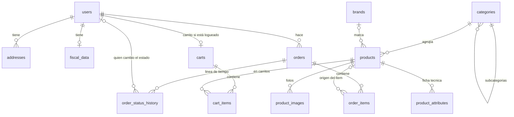

# Elenor

Tienda online de materiales eléctricos y herramientas para Tucumán y el NOA (Argentina).

## Stack

- Laravel 13 sobre PHP 8.3
- Blade + Livewire 4 + Alpine.js (Alpine viene incluido en Livewire; no se carga aparte)
- Tailwind CSS 4 con Vite 8, tipografía Montserrat autohospedada
- MySQL 8 (InnoDB)
- Laravel Socialite para el login con Google (Etapa 3)

## Requisitos

- Windows con WAMP64: PHP **8.3**, MySQL **8** (puerto 3306) y Apache con `mod_rewrite`
- Composer 2
- Node 22 o superior (trae npm)
- Git

### Ojo: el PHP de la consola

Apache usa el PHP que elegís en el menú de WAMP (PHP → Versión → 8.3.x), pero **Composer y Artisan usan el `php` del PATH**, que puede ser otro. Laravel 13 necesita 8.3. Antes de trabajar, en PowerShell:

```powershell
$env:Path = "C:\wamp64\bin\php\php8.3.28;" + $env:Path
php -v   # tiene que decir 8.3.x
```

Para que quede fijo, poné `C:\wamp64\bin\php\php8.3.28` al principio del PATH del sistema (ajustá la versión si WAMP trae otra).

## Puesta en marcha en WAMP

Todos los comandos se corren desde la carpeta del proyecto (`C:\wamp64\www\elenor`), con PHP 8.3 en el PATH.

### 1. Dependencias

```powershell
composer install
npm install
```

### 2. Configuración

```powershell
copy .env.example .env
php artisan key:generate
```

El `.env.example` ya viene con los valores de WAMP: MySQL en `127.0.0.1:3306`, usuario `root` sin contraseña, base `elenor`. Los datos de contacto del sitio (`SHOP_*`) son ficticios: reemplazalos por los reales.

### 3. Bases de datos

Creá dos bases (desde phpMyAdmin o la consola de MySQL). `elenor_test` es la que usan los tests, así nunca tocan tus datos:

```sql
CREATE DATABASE elenor CHARACTER SET utf8mb4 COLLATE utf8mb4_unicode_ci;
CREATE DATABASE elenor_test CHARACTER SET utf8mb4 COLLATE utf8mb4_unicode_ci;
```

Después, las tablas y los datos de ejemplo (categorías, marcas, productos y algunos usuarios):

```powershell
php artisan migrate --seed
```

El seeder crea la cuenta de administrador con el email de `SHOP_ADMIN_EMAIL` (en el `.env`): poné ahí tu email de Google **antes** de sembrar. Se puede volver a correr sin duplicar nada.

### 4. Assets (CSS y JS)

`public/build` no se versiona: hay que generarlo.

```powershell
npm run build   # una vez, para probar
npm run dev     # mientras desarrollás (recarga al guardar)
```

### 5. Virtual host `elenor.test`

**Opción A, con la herramienta de WAMP:** abrí `http://localhost/add_vhost.php`, usá el nombre `elenor.test` y la ruta `c:/wamp64/www/elenor/public`, y después reiniciá el DNS y los servicios desde el menú de WAMP.

**Opción B, a mano:**

1. Abrí el Bloc de notas **como administrador** y agregá esta línea al archivo `C:\Windows\System32\drivers\etc\hosts`:

   ```text
   127.0.0.1 elenor.test
   ```

2. Agregá este bloque al final de `C:\wamp64\bin\apache\apache2.4.65\conf\extra\httpd-vhosts.conf` (la carpeta cambia con la versión de Apache):

   ```apache
   <VirtualHost *:80>
     ServerName elenor.test
     DocumentRoot "c:/wamp64/www/elenor/public"
     <Directory "c:/wamp64/www/elenor/public/">
       Options +FollowSymLinks
       AllowOverride All
       Require all granted
     </Directory>
   </VirtualHost>
   ```

3. Clic derecho en el ícono de WAMP → **Reiniciar todos los servicios**.

Listo: abrí <http://elenor.test>.

> Sin virtual host también se puede probar con `php artisan serve --port=8000` (abrí <http://127.0.0.1:8000>). Los links se arman con el host del pedido, así que funcionan igual.

## Día a día

```powershell
npm run dev                 # assets con recarga automática
php artisan test            # tests (usan la base elenor_test)
php vendor\bin\pint         # formato de código (estilo Laravel)
php artisan migrate:fresh --seed   # borra todo y rehace la base de desarrollo con los datos de ejemplo
```

## Particularidades del MySQL de WAMP

El MySQL de WAMP viene con `default_storage_engine=MYISAM` y `sql_mode` vacío. MyISAM no tiene transacciones, bloqueo de filas ni claves foráneas, y los pedidos necesitan las tres cosas. Por eso `config/database.php` fuerza **InnoDB** y modo estricto en la conexión de la app (y un test lo verifica). No hace falta tocar el `my.ini`, pero cualquier tabla creada por fuera de Laravel (a mano, desde phpMyAdmin) saldría MyISAM si no se indica `ENGINE=InnoDB`.

## Estructura

```text
app/
├─ Enums/                       estados, roles, unidades… (con etiquetas en español)
├─ Exceptions/                  GoogleLoginException (rechazos del login, con mensaje para el cliente)
├─ Http/                        controladores (Auth, Account), middleware y Form Requests
├─ Livewire/                    componentes Livewire (clase + vista)
├─ Models/                      modelos Eloquent
├─ Services/                    GoogleUserResolver (crear/recuperar usuario) y CartService
├─ Support/                     Money, Cuit y helpers (money())
└─ View/Components/Layout/      componentes de layout con lógica (barra de categorías, menú móvil)
config/shop.php                 moneda ARS, datos de contacto y email del admin
database/
├─ migrations/                  una por tabla
├─ factories/                   una por modelo, con estados
└─ seeders/                     categorías, marcas, productos y usuarios de ejemplo
lang/es/                        textos de Laravel en español
resources/
├─ css/app.css                  Tailwind + colores y tipografía de la marca (@theme)
├─ fonts/                       Montserrat (woff2) y su licencia
├─ js/app.js                    arranque de Livewire (que arranca Alpine)
└─ views/
   ├─ layouts/app.blade.php     layout principal: <x-layouts::app>
   ├─ components/layout/        header, footer, menú móvil, barra de categorías, logo
   ├─ components/button.blade.php
   └─ livewire/                 vistas de los componentes Livewire
routes/web.php                  URLs en español, nombres de ruta en inglés
tests/                          Unit y Feature (contra MySQL)
```

## Login con Google

El ingreso es **solo con Google** (Laravel Socialite): no hay contraseñas. Hay que crear las credenciales una vez en Google Cloud y copiar tres valores al `.env`.

### Por qué no se puede probar en `elenor.test`

Según la documentación de Google, las URI de redirección tienen que usar **HTTPS** (solo `localhost` está exento) y el dominio tiene que pertenecer a la **Public Suffix List**; `.test` no está. Por eso:

| Entorno | Cómo se abre el sitio | URI de redirección |
| --- | --- | --- |
| Local | `http://localhost:8000` con `php artisan serve` | `http://localhost:8000/auth/google/callback` |
| Producción | `https://TU-DOMINIO` | `https://TU-DOMINIO/auth/google/callback` |

El resto del sitio sigue andando en `elenor.test`. Para probar el login, abrí **exactamente** `http://localhost:8000` (no `127.0.0.1`): la URI tiene que coincidir letra por letra con la registrada en Google (esquema, host, puerto y barra final), y la cookie de sesión es por host.

### Paso a paso en Google Cloud Console

La consola cambia seguido; si algún nombre no coincide, buscá el equivalente (en español suele aparecer como *Público*, *Clientes* y *Acceso a los datos*).

1. Entrá a <https://console.cloud.google.com> con la cuenta de Google que va a administrar el proyecto y creá un **proyecto** nuevo (selector de proyectos, arriba a la izquierda), por ejemplo "Elenor".
2. Abrí **Google Auth Platform** (menú ☰, o buscalo en la barra de arriba) y tocá **Comenzar** (*Get started*):
   - **Información de la app:** nombre `Elenor` y tu email como contacto de asistencia.
   - **Público** (*Audience*): **Externo**. (*Interno* requiere una organización de Google Cloud.)
   - **Información de contacto:** tu email.
   - Aceptá la política de datos de usuario y **Crear**.
3. En **Acceso a los datos** (*Data Access*) → *Agregar o quitar permisos*: marcá `openid`, `…/auth/userinfo.email` y `…/auth/userinfo.profile`, y guardá. Son los únicos que pide la app (nombre, email y foto), y no requieren la verificación de Google para permisos sensibles.
4. En **Clientes** (*Clients*) → **Crear cliente**: tipo **Aplicación web**, nombre `Elenor local`. En **URI de redireccionamiento autorizados** agregá `http://localhost:8000/auth/google/callback`. Los "orígenes de JavaScript" se dejan vacíos: el flujo es del lado del servidor.
5. Al crear el cliente Google muestra el **ID de cliente** y el **secreto**. Copialos al `.env`:

   ```dotenv
   GOOGLE_CLIENT_ID=...
   GOOGLE_CLIENT_SECRET=...
   GOOGLE_REDIRECT_URI=http://localhost:8000/auth/google/callback
   ```

   El secreto completo se muestra **una sola vez**: guardalo en ese momento. Si se pierde, desde la pantalla del cliente se puede agregar uno nuevo.
6. `php artisan config:clear`, levantá `php artisan serve` y abrí <http://localhost:8000/ingresar>.

Mientras la app esté en estado **Testing** (*Público* → estado de publicación), Google permite hasta 100 usuarios de prueba. Para los permisos básicos (`openid`, `email`, `profile`) la documentación dice que cualquier cuenta puede ingresar, pero no es del todo consistente: si Google te rechaza una cuenta, agregala en *Público* → *Usuarios de prueba*.

### Pasar a producción

1. Creá **otro cliente** (`Elenor producción`) con la URI `https://TU-DOMINIO/auth/google/callback`. Cada entorno usa su propio ID y secreto.
2. En el `.env` del servidor: `APP_URL=https://TU-DOMINIO`, `GOOGLE_CLIENT_ID`, `GOOGLE_CLIENT_SECRET`, `GOOGLE_REDIRECT_URI` (igual a la URI registrada) y `SESSION_SECURE_COOKIE=true`.
3. En **Público**, tocá **Publicar app** para que cualquier cliente pueda ingresar.
4. En **Branding** cargá la página de inicio, la **política de privacidad** y los **términos y condiciones** del sitio: Google los pide para apps externas en producción. Esas páginas todavía no existen.
5. Opcional: la *verificación de marca* hace que la pantalla de Google muestre el nombre y el logo; sin ella solo se ve el dominio.

### Cómo funciona

- `/auth/google/redirect` manda a Google (pide siempre el selector de cuenta). Socialite guarda un `state` aleatorio en la sesión y el callback lo verifica: protege el flujo contra CSRF.
- `/auth/google/callback` canjea el `code` por los datos del usuario **en el servidor**. La cuenta se busca primero por `google_id` y después por email, y solo si Google confirma que el email está verificado. Así, el admin cargado por el seeder (`SHOP_ADMIN_EMAIL`) queda enlazado en su primer ingreso y conserva su rol.
- Nunca se escribe el rol, el tipo de cuenta ni el estado profesional desde Google: los clientes nuevos son `customer` / consumidor final.
- Al ingresar se regenera la sesión y el carrito de invitado se fusiona con el del cliente. Si todavía no tiene teléfono, se lo pedimos y después lo llevamos a la página que quería (por ejemplo, el checkout). Las rutas que necesitan un teléfono usan el middleware `phone`.
- Los clientes quedan recordados (cookie de "recordarme"); el personal (admin, ventas, depósito) tiene que volver a ingresar cuando vence la sesión.

### Si algo falla

- **`redirect_uri_mismatch` en la pantalla de Google:** la URI del `.env` no coincide exactamente con la registrada (host, puerto o barra final).
- **"No pudimos ingresar con Google" al volver:** casi siempre se perdió la sesión, por abrir el sitio con otro host que el de la URI (`127.0.0.1` en vez de `localhost`), o `GOOGLE_CLIENT_SECRET` incorrecto. El detalle queda en `storage/logs`.
- **"El ingreso con Google todavía no está disponible":** faltan variables en el `.env` o está cacheada la configuración (`php artisan config:clear`).
- **Dar permisos de admin a una cuenta que ya ingresó** (hasta que exista el panel de la Etapa 6):

  ```powershell
  php artisan tinker --execute="App\Models\User::where('email', 'persona@gmail.com')->firstOrFail()->forceFill(['role' => App\Enums\UserRole::Admin])->save();"
  ```

## Modelo de datos



Lo que conviene saber:

- **Dinero** en `decimal(12,2)`; **cantidades y stock** en `decimal(10,2)`, para vender cable por metro. Se calculan en el servidor con `bcmath`, nunca con floats.
- **Restricciones en MySQL** (`CHECK`): stock ≥ 0, precios ≥ 0 y cantidades > 0. Aunque falle el código, la base no deja vender de más ni guardar importes negativos.
- **Los pedidos no cambian por cambios en el catálogo**: cada item guarda nombre, SKU, unidad y precio congelados, y el pedido guarda una copia de la dirección. Si un producto se borra, el pedido conserva todo.
- **Sin contraseñas**: el acceso es solo con Google. El rol, el tipo de cuenta y la aprobación profesional nunca se asignan desde un formulario.
- **Precio profesional**: lo decide `Product::priceFor($usuario)`, solo para cuentas profesionales o empresas aprobadas.

## Etapas

- [x] **1. Base del proyecto**: Laravel, Livewire, Tailwind, layout principal
- [x] **2. Modelo de datos**: usuarios, categorías, productos, carritos, pedidos y seeders
- [x] **3. Login con Google**: Socialite, usuarios, carrito de invitado y teléfono
- [ ] 4. Catálogo (inicio, listados con filtros, buscador, ficha de producto)
- [ ] 5. Carrito y checkout
- [ ] 6. Panel administrativo e importación de precios

Las reglas y convenciones del proyecto están en [CLAUDE.md](CLAUDE.md).
